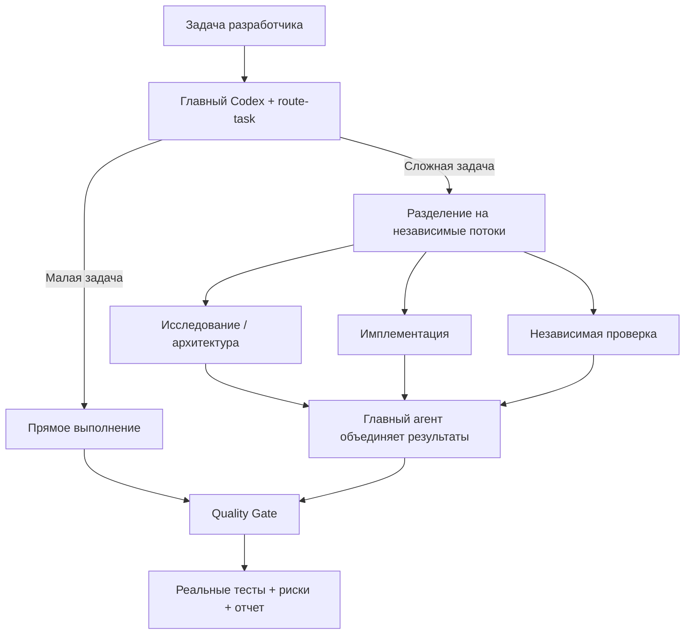

<div align="center">

# ForgeQuorum

### One prompt. An entire engineering team.

**20 specialized agents · 14 reusable skills · Safe installer · Zero runtime dependencies**

Native Codex configuration for engineering teams: architecture, Python backend, frontend, security, PostgreSQL, debugging, QA, DevOps, integrations and release engineering.

[Быстрый старт](#быстрый-старт) · [Как работает](#как-работает) · [Команды](#cli-команды) · [Безопасность](#безопасность) · [English](README.en.md)

</div>

> **Версия 0.1.0 — рабочий MVP.** Установщик, проверки и шаблоны агентов протестированы локально. Реальная работа субагентов зависит от установленной версии Codex, доступных инструментов и прав вашей сессии. Этот пакет **не является** самостоятельным облачным сервисом и не запускает OpenAI API-запросы из Python.

## Зачем это нужно

Одной модели часто поручают одновременно исследовать архитектуру, писать код, проверять безопасность и тестировать собственные изменения. На больших задачах полезнее разделить роли и вернуть независимые результаты главному агенту. Но «больше агентов» не всегда означает «лучше»: координация тоже требует контекста и времени.

ForgeQuorum добавляет в репозиторий **нативные** для Codex определения субагентов (`.codex/agents`), переиспользуемые навыки (`.agents/skills`), инструкции `AGENTS.md` и пример конфигурации. Никакого патча клиента, стороннего сервера или токена API для установки не требуется.

ForgeQuorum — независимый open-source проект для Codex, не являющийся официальным продуктом OpenAI. Это самостоятельная реализация, не форк Everything Claude Code.

## Быстрый старт

Требования: **Python 3.11+**, локальная копия данного проекта и рабочий **Codex** (CLI, IDE или поддерживаемый клиент).

```bash
# В каталоге Forge-Quorum
python -m pip install -e .

# Посмотреть изменения БЕЗ записи
 forgequorum init --target ../my-project --dry-run

# Добавить агентов и навыки в существующий проект
 forgequorum init --target ../my-project

# Проверить целостность
 forgequorum doctor --target ../my-project
```

Для Windows PowerShell:

```powershell
py -m pip install -e .
forgequorum init --target C:\Projects\my-project --dry-run
forgequorum init --target C:\Projects\my-project
forgequorum doctor --target C:\Projects\my-project
```

Откройте **целевой репозиторий** в Codex и начните, например, с:

```text
$route-task Разберись в этом репозитории. Нужно внедрить авторизацию
через OAuth, не сломать существующие сессии, добавить тесты и провести
независимое security review. Используй только необходимых агентов,
раздели ответственность по файлам и покажи реальные результаты проверок.
```

Или с конкретного процесса:

```text
$repair-bug Найди причину повторной обработки одного event_id в воркере,
добавь тест на повторную доставку и исправь без потери событий.
```

Кодекс может подобрать подходящий навык автоматически, а `$имя-навыка` запускает его явно. Чтобы увидеть активных субагентов в CLI, используйте `/subagents` (если команда доступна в установленной версии).

## Как работает



Правила маршрутизации:

- Не запускать агента ради изменения одной строки.
- Исследователь и ревьюер не редактируют код; это **поведенческое правило**, не отдельный sandbox.
- Параллельные исполнители получают непересекающиеся зоны записи.
- Главный Codex отвечает за интеграцию, тесты и итоговую проверку.
- Не публиковать, не деплоить, не удалять данные и не повышать права без разрешения пользователя.

### Агенты (20)

| Группа | Роли |
|---|---|
| Архитектура | `architect`, `planner`, `repo-explorer`, `product-analyst` |
| Разработка | `python-backend`, `frontend-engineer`, `api-designer`, `integration-engineer` |
| Надежность | `database-engineer`, `debugger`, `test-engineer`, `performance-engineer` |
| Безопасность | `security-auditor`, `threat-modeler`, `dependency-auditor` |
| Эксплуатация | `devops-engineer`, `observability-engineer`, `release-manager` |
| Контроль качества | `reviewer`, `docs-writer` |

Это роли, а не отдельные обученные модели. Кодекс использует определения ролей для своих нативных субагентов.

### Навыки (14)

| Навык | Для чего |
|---|---|
| `$route-task` | Минимальная команда под задачу |
| `$build-feature` | Фича от требований до тестов |
| `$repair-bug` | Воспроизведение и исправление дефекта |
| `$deep-review` | Независимое ревью изменений |
| `$security-gate` | Угрозы и проверка защиты |
| `$ship-api` | API и интеграционные контракты |
| `$data-migration` | Безопасная миграция данных |
| `$performance-lab` | Измеримая оптимизация |
| `$incident-triage` | Анализ сбоев и инцидентов |
| `$repo-onboarding` | Карта незнакомого проекта |
| `$release-ready` | Контроль релиза и отката |
| `$automation-hardening` | Очереди, вебхуки и Telegram-боты |
| `$docs-sync` | Актуализация документации |
| `$pr-preflight` | Проверка перед pull request |

## CLI-команды

```bash
forgequorum list                       # все роли и навыки
forgequorum init --target PATH         # установка в проект
forgequorum init --target PATH --dry-run
forgequorum doctor --target PATH       # проверка TOML, навыков, манифеста
forgequorum uninstall --target PATH    # удалить только неизмененные управляемые файлы
forgequorum uninstall --target PATH --dry-run
forgequorum --version
```

При установке создаются:

```text
my-project/
├── AGENTS.md                      # блок проекта добавляется, без замены других правил
├── .codex/
│   ├── config.toml                # только если ранее отсутствовал
│   └── agents/
│       ├── architect.toml
│       ├── security-auditor.toml
│       └── ...                    # всего 20
├── .agents/
│   └── skills/
│       ├── route-task/SKILL.md
│       ├── build-feature/SKILL.md
│       └── ...                    # всего 14
└── .forgequorum/
    ├── manifest.json              # контрольные суммы управляемых файлов
    └── config.example.toml        # только если config.toml уже существовал
```

Если `.codex/config.toml` уже есть, установщик **не перезаписывает его**. Вместо этого создается `.forgequorum/config.example.toml`; объедините только нужные `[agents]` настройки вручную. Учитывайте, что проектная конфигурация Codex может загружаться только для доверенных проектов.

### Что не делает установщик

- Не меняет глобальный `~/.codex/config.toml` и не требует ключей.
- Не устанавливает и не подменяет Codex.
- Не перезаписывает чужие агенты и файлы; при конфликте останавливается до начала записи.
- Не выполняет сетевые запросы, не загружает скрипты из интернета и не запускает hooks.
- Не утверждает, что тесты вашего проекта прошли: это должен подтвердить Codex в реальной сессии.

## Безопасность

Установщик использует манифест с SHA-256 для каждого своего файла. Повторная установка идемпотентна. Отредактированные пользователем файлы не затираются и не удаляются автоматически. Управляемый раздел в `AGENTS.md` отмечен комментариями и удаляется отдельно от остальных инструкций. Проверяется, что управляемые пути не используют символьные ссылки.

**Ограничение:** описания ролей и навыков — инструкции модели, а не техническая граница привилегий. Субагенты наследуют разрешения родительского Codex. Защиту критичных действий обеспечивают настройки sandbox/approval самого клиента и внешние политики вашей организации.

## Разработка и тесты

```bash
python -m pip install -e .
python -m unittest discover -s tests -v
```

CI настроен для Ubuntu и Windows, Python 3.11 и 3.13. Наличие workflow не означает, что удаленный CI уже запущен: это произойдет после публикации репозитория на GitHub.

## Планы

См. [ROADMAP.md](ROADMAP.md). Направления: безопасный глобальный installer, визуализация агентных команд и стоимости, адаптивное распределение моделей и контекста, управление worktree и отдельный режим оркестрации через OpenAI API. **Пока это планы, не заявленные возможности 0.1.0.**

## Источники совместимости

- [Codex: customization, skills, AGENTS.md](https://learn.chatgpt.com/docs/customization/overview)
- [Codex: custom subagents](https://learn.chatgpt.com/docs/agent-configuration/subagents)
- [Codex: configuration reference](https://learn.chatgpt.com/docs/config-file/config-reference)

Лицензия: [MIT](LICENSE). © 2026 Dimash Janibekov.
