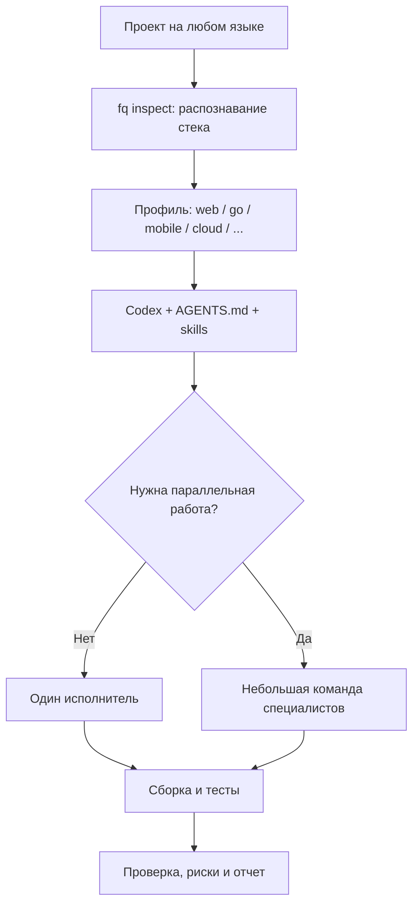

<div align="center">

# ForgeQuorum

### One prompt. An entire engineering team.

**52 инженерные роли · 39 навыков · 25 профилей · Нативная интеграция с Codex**

Открытый многоязычный инструментарий для проектирования, разработки, тестирования и проверки качества с помощью Codex: специализированные роли, повторно используемые навыки, безопасный установщик и воспроизводимые проверки.

[Быстрый старт](#быстрый-старт) · [Возможности](docs/CAPABILITIES.md) · [Архитектура](docs/ARCHITECTURE.md) · [Оркестрация](docs/ORCHESTRATION.md) · [English](README.en.md)

</div>

> **v0.9.0 — многоязычный Codex toolkit, планировщик и очередь задач.** Есть безопасное создание Git worktree и запуск `codex exec` только с `--execute`. Поддержаны отдельные параллельные запуски подготовленных задач (до 4 процессов в одном batch), но это **не автономный AI-планировщик**. Настоящих субагентов запускает Codex при наличии поддержки и разрешений. Ни одна специализация не гарантирует, что в среде пользователя установлен нужный SDK, компилятор или тестовый раннер.

## Установка: два способа

**Нативный плагин Codex** — подключает переносимые навыки без обязательной установки Python. В клиенте Codex с поддержкой плагинов добавьте каталог и включите ForgeQuorum:

```text
codex plugin marketplace add DizzyZ7/Forge-Quorum
```

Вызовите `$route-task`, `$verification-loop`, `$test-driven-loop` или `$context-checkpoint`. Набор из 52 пользовательских субагентов устанавливается отдельно через CLI; сам плагин не регистрирует их автоматически. Доступность команд установки зависит от версии клиента Codex, а живое подключение еще не проверено во всех его версиях.

**CLI для проекта** — устанавливает роли и навыки в конкретный репозиторий и дает локальные инструменты диагностики:

```bash
python -m pip install --upgrade "git+https://github.com/DizzyZ7/Forge-Quorum.git"
fq inspect --target ./my-project
fq init --target ./my-project --profile auto
fq doctor --target ./my-project
```

Выберите один способ подключения навыков, чтобы избежать их дублирования. Для необязательных проверок используйте `fq verify` (только план) и `fq verify --run` (явный запуск тестов проекта). Команды `--run` не изолированы самим ForgeQuorum и могут исполнять недоверенный код — сначала проверьте план. Hooks не активируются автоматически; пример ручной настройки находится в [`examples/hooks/session-start.toml.example`](examples/hooks/session-start.toml.example).

Подробный реестр реализованных функций и ограничений — в [CAPABILITIES](docs/CAPABILITIES.md). Это независимый проект с собственными исходными файлами и MIT-лицензией.

## Очередь задач: приоритеты и зависимости (v0.9.0)

Очередь использует существующий Git-репозиторий и создает отдельный worktree на каждую задачу. `queue add` только планирует работу; запуск модели возможен исключительно с `queue run --execute`. Сортировка — по убыванию приоритета, затем FIFO. При падении зависимости последующие задачи блокируются до ручного решения.

```bash
fq queue add "Добавить API" --target . --priority 20 --profile go
fq queue add "Добавить тесты API" --target . --priority 80 --after <job-id-api>
fq queue status --target .                   # текущая готовность задач
fq queue run --target . --max-jobs 2         # предпросмотр, без модели
fq queue run --target . --max-jobs 2 --parallel 2 --execute
fq queue watch --target . --seconds 30       # foreground JSONL по изменениям состояния
fq queue priority <job-id> 90 --target . --confirm
fq queue cancel <job-id> --target . --confirm  # только ожидающая задача
fq queue retry <job-id> --target . --confirm   # повторить после сбоя
fq queue recover <job-id> --target . --confirm # после проверки завершения PID
```

**Внимание:** `--after` задает *порядок выполнения*, а не перенос патчей, коммитов или контекста предыдущего агента. Ветка зависимой задачи создается из HEAD при постановке в очередь. Завершение Codex не означает успешных тестов — проверяйте каждый результат командой `fq swarm verify <id> --run` и `fq swarm handoff`. `watch` только опрашивает метаданные в текущем терминале, без фонового сервиса или чтения стенограммы. Обработка аварий завершает работу консервативно: зависшие claims не снимаются автоматически. Подробнее: [docs/ORCHESTRATION.md](docs/ORCHESTRATION.md).

## Изолированные задачи Codex

Теперь можно создать отдельную рабочую ветку и Git worktree для задачи, посмотреть план и **только затем** запустить Codex. Никаких скрытых API-запросов при планировании или создании worktree.

```bash
fq swarm plan "Сделай Go API с тестами" --target . --json
fq swarm start "Сделай Go API с тестами" --target . --json
fq swarm list --target .
fq swarm run <job-id> --target .                 # только показать команду
fq swarm run <job-id> --target . --execute      # явный запуск Codex
fq swarm status <job-id> --target .
fq swarm review <job-id> --target .               # отчет Git, только чтение
fq swarm batch <job-a> <job-b> --target . --max-parallel 2           # предварительная проверка
fq swarm batch <job-a> <job-b> --target . --max-parallel 2 --execute # реальный параллельный запуск
fq swarm conflicts <job-a> <job-b> --target .     # пересечения файлов между задачами
fq swarm verify <job-id> --target .               # план проверок (без запуска)
fq swarm verify <job-id> --target . --run         # выполнить тесты в worktree
fq swarm usage --target .                         # сообщенные Codex токены
fq swarm cancel <job-id> --target . --confirm     # запросить остановку
fq swarm recover <job-id> --target . --confirm    # пометить прерванным, только без lock
fq swarm cleanup <job-id> --target . --confirm   # удалит только чистое worktree
```

Запуск может расходовать токены. Все задачи создаются от закоммиченного `HEAD`; несохраненные в коммит изменения не копируются и не теряются. Работа не сливается в `main` автоматически, ветка остается для ревью. Установленные агенты должны быть закоммичены до создания worktree, если они нужны внутри него. Подробности: [docs/ORCHESTRATION.md](docs/ORCHESTRATION.md).

## Зачем ForgeQuorum

Один AI-ассистент одновременно исследует код, пишет фичу, проверяет собственный код и оформляет релиз. ForgeQuorum позволяет распределить эти обязанности между более подходящими **ролями**, учитывая язык проекта, специализацию и риск изменений. Роли — это инструкции, а не отдельные обученные модели или новые привилегии.

- **Многоязычность:** специализации для Python, TypeScript, Java, Kotlin, Go, Rust, C#, C/C++, PHP, Ruby, Swift, Dart, R, Julia, MATLAB и других экосистем.
- **Full-stack и не только:** backend, frontend, мобильная, desktop, game, data/ML, SRE, security, QA, UX, cloud и embedded-разработка.
- **Автовыбор:** `fq inspect` проверяет только имена файлов и манифесты; `--profile auto` подбирает готовый профиль.
- **Контроль исполнения:** атомарная блокировка одного job от дублирования, частичные результаты параллельных запусков и Git-отчет для ревью; есть межпроцессный лимит запусков, консервативный дневной резерв токенов, очередь приоритетов и анализ готовности к ручному объединению. Это не жесткий лимит расходов и не автоматический merge.
- **Рациональная команда:** `fq recommend` предлагает 1–6 специалистов без API; `fq swarm` готовит отдельную ветку, а реальный запуск Codex требует `--execute`.
- **Безопасная интеграция:** файлы пользователя и существующий `AGENTS.md` сохраняются. Управляемые файлы отслеживаются по SHA-256.

### Важное различие

ForgeQuorum написан на Python **только как CLI-установщик** (Python 3.11+ и стандартная библиотека). Он устанавливается в репозиторий **любого языка** и не требует Python как рантайм разрабатываемого приложения. В будущих версиях можно добавить автономные бинарные установщики или пакетные менеджеры.

## Быстрый старт

Установите ForgeQuorum (нужны Python 3.11+, `pip` и `git`):

```bash
python -m pip install --upgrade "git+https://github.com/DizzyZ7/Forge-Quorum.git"
```

Проверьте стек и состав команды **до установки**:

```bash
fq inspect --target ../my-project
fq profiles
fq recommend "Сделай Rust-сервис с очередями и безопасной остановкой" --target ../my-project
```

Установка с автоопределением (можно сначала проверить запись):

```bash
fq init --target ../my-project --profile auto --dry-run
fq init --target ../my-project --profile auto
fq doctor --target ../my-project
```

Windows PowerShell:

```powershell
py -m pip install --upgrade "git+https://github.com/DizzyZ7/Forge-Quorum.git"
fq inspect --target C:\Projects\MyApp
fq init --target C:\Projects\MyApp --profile auto --dry-run
fq init --target C:\Projects\MyApp --profile auto
fq doctor --target C:\Projects\MyApp
```

Откройте **этот проект** в Codex и дайте задачу:

```text
$route-task Исследуй стек и существующие договоренности проекта.
Добавь новую фичу end-to-end. Назначь только подходящих специалистов,
раздели зоны записи, проверь безопасность и запусти реальные тесты.
Не придумывай результаты и запроси разрешение перед деплоем.
```

## Как это работает



`fq inspect` **не читает содержимое исходников** и не запускает команды проекта. Он использует расширения файлов, названия манифестов, признаки мобильных/игровых проектов, пропускает каталоги зависимостей и ограничивает число просмотренных файлов. Поэтому `auto` — **эвристика**, а не гарантия точного распознавания большого монорепозитория. В сомнительных случаях используйте `--profile full`, `backend` или явный технологический профиль.

При установке создаются `.codex/agents/<role>.toml`, `.agents/skills/<skill>/SKILL.md`, управляемый фрагмент `AGENTS.md`, `.forgequorum/manifest.json` и, при отсутствии, `.codex/config.toml`. Существующая конфигурация Codex не перезаписывается: вместо этого предлагается пример для ручного объединения.

## Технологии и роли

| Направление | Примеры специализаций |
|---|---|
| Web & API | `frontend-engineer`, `node-backend`, `python-backend`, `java-engineer`, `go-engineer`, `dotnet-engineer`, `php-engineer`, `ruby-engineer` |
| JVM & systems | `kotlin-engineer`, `rust-engineer`, `cpp-engineer`, `embedded-engineer`, `systems-engineer`, `functional-engineer` |
| Mobile & desktop | `android-engineer`, `swift-engineer`, `flutter-engineer`, `desktop-engineer`, `mobile-qa` |
| Games | `game-engineer`, `performance-engineer`, `qa-automation` |
| Data & AI | `database-engineer`, `data-engineer`, `ml-engineer`, `mlops-engineer`, `scientific-engineer` |
| Cloud & operations | `cloud-architect`, `terraform-engineer`, `kubernetes-engineer`, `sre-engineer`, `network-engineer`, `devops-engineer` |
| Product & quality | `architect`, `planner`, `reviewer`, `test-engineer`, `security-auditor`, `privacy-engineer`, `accessibility-engineer`, `uiux-designer` |

Список всех 52 ролей: `fq list`. Подробная карта стека: [docs/LANGUAGE-SUPPORT.md](docs/LANGUAGE-SUPPORT.md).

### Примеры сценариев (39 skills)

| Навык | Назначение |
|---|---|
| `$polyglot-feature` | Фича на нескольких языках с согласованием API и интеграционными тестами |
| `$ship-jvm-service`, `$ship-go-service`, `$ship-rust-crate`, `$ship-dotnet` | Реализация на нативном стеке и его проверках |
| `$build-mobile`, `$build-desktop`, `$gameplay-iteration` | Мобильная/десктопная/игровая разработка |
| `$data-pipeline`, `$ml-lifecycle` | Данные, ML, RAG и воспроизводимые оценки качества |
| `$infrastructure-plan`, `$kubernetes-operations` | Проверка инфраструктурных изменений до применения |
| `$systems-safety`, `$concurrency-review`, `$security-gate` | Уязвимости, многопоточность, безопасность |
| `$test-strategy`, `$accessibility-audit`, `$cross-platform-release` | Тестирование, доступность, платформенные релизы |
| `$build-feature`, `$repair-bug`, `$route-task`, `$pr-preflight` | Универсальные инженерные сценарии |

Каталог расширяется без копирования чужих определений агентов. Навыки явно различают выполненные проверки, недоступные инструменты и действия, требующие разрешения.

## Команды CLI

```bash
fq list                                 # каталог ролей и навыков
fq profiles                             # 25 ручных профилей + auto
fq inspect --target PATH --json         # стек проекта, без чтения исходников
fq init --target PATH --profile auto    # выбрать профиль по проекту
fq init --target PATH --profile mobile  # или указать вручную
fq init --target PATH --profile full    # весь каталог (52 + 34)
fq init --target PATH --dry-run         # предварительный список изменений
fq doctor --target PATH --json          # диагностика целостности
fq status --target PATH --json          # отчет для CI/скриптов
fq recommend "Build Spring Boot API" --profile java --json
fq recommend "Fix a Go API endpoint" --target PATH --profile auto --json
fq uninstall --target PATH --dry-run
fq uninstall --target PATH
```

Конкретный установленный профиль сохраняется в манифесте. Повторный `init` обновляет **тот же** профиль, не перезаписывая ваши правки. При необходимости сменить профиль нужно сначала выполнить `uninstall`; измененные файлы сохраняются и требуют ручного разрешения конфликта. Старые установки v0.1/v0.2 распознаются.

Рекомендации `fq recommend` детерминированы и основаны на ключевых словах и, если передан `--target`, эвристике стека. Реальное назначение и запуск субагентов — функция Codex. Мы не называем рекомендации интеллектуальной моделью.

## Безопасность и ограничения

- Нет фонового запуска команд, сетевых запросов или чтения содержимого приложений во время `inspect` и `recommend`.
- Существующие `AGENTS.md`, `.codex/config.toml` и пользовательские файлы не затираются.
- Роли «read-only» — **инструкции поведения**, а не независимые изолированные окружения. Разрешения наследуются от родительской сессии Codex.
- Обновления сохраняют измененные пользователем управляемые файлы. Манифест — локальный реестр с допустимыми путями, **не криптографическая защита от злоумышленника с доступом на запись**.
- Код не публикуется, не деплоится и не выполняет опасные операции без соответствующих разрешений.
- Полиглотное тестирование вашего приложения требует реальных SDK, библиотек и CI окружений, которые ForgeQuorum **не устанавливает**.

## Для разработчиков

```bash
python -m pip install -e .
python -m unittest discover -s tests -v
```

CI запускает тесты установщика и маршрутизатора на Ubuntu/Windows с Python 3.11/3.13; **это не интеграционные тесты с реальными агентами Codex на всех языках**.

Читайте [ARCHITECTURE](docs/ARCHITECTURE.md), [CHANGELOG](CHANGELOG.md), [ROADMAP](ROADMAP.md) и [CONTRIBUTING](CONTRIBUTING.md). Вклад новых языков и сценариев приветствуется — добавляйте роли со стек-специфичными правилами и проверяемыми тестами, а не просто новые названия.

Если инструмент полезен, поставьте ⭐ репозиторию: это помогает другим разработчикам найти проект.

**MIT License · © 2026 Dimash Janibekov (DizzyZ7).** Независимый community-проект; не связан с OpenAI официально.
